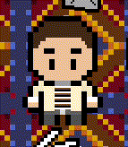
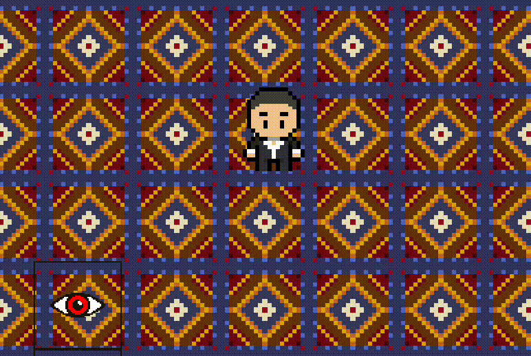

# 🐬 so_long

## 📝 About

**so_long** is the first graphics project of **École 42** introducing students to **basic computer graphics** and **game development**.

The objective is to create a 2D *(top-down view)* game with `MiniLibX`. The rules are simple : The player is in a closed map with one or more collectibles, and he must collect them all to open the exit to go inside. 

---

## MiniLibX Usage

I wrote a short manual on the basics of MiniLibX : [So_Long_Man](https://arthuroberon.notion.site/So_Long_Man-19d70fea9d6548e9aa952cf3a955a9ce).

## ⚙️ Usage

### 🏗️ Compilation

```sh
make				# make the game
make bonus			# make the game (same as make)
make clean			# remove object files
make fclean			# remove object files + so_long binary + cloned MiniLibX
make re				# rebuild everything
```

###  Play

#### Create a Map

A map is a `.ber` file. It must :
- Have a `.ber` extension on the file.
- constructed with 3 components: walls, collectibles, and free space.
- composed of only these 5 characters:
	- `0` for an empty space.
	- `1` for a wall.
	- `C` for a collectible.
	- `E` for a map exit.
	- `P` for the player’s starting position.
- contain :
	- 1 exit.
	- 1 starting position.
	- at least 1 collectible.
- be rectangular.
- be enclosed/surrounded by walls.

A minimal example of an `.ber` map :
```
1111111111111
10010000000C1
1000011111001
1P0011E000001
1111111111111
```

If you don't want to create your own map, there are plenty of valids maps in the folder : `maps/valid/`.

### Launch the Game

Then, to launch the game, simply execute this command :

```sh
./so_long <path_to_your_map>
```


But before playing, remember to read the manuel :

---

## 💵 Ocean's Eleven

			A smash and grab job?
			-
			Slightly more complicated than that.

Tonight, pull off the biggest heist Las Vegas has ever seen. Steal $160 000 000 from the vaults of 3 casinos : The Bellagio, The Mirage, and The M.G.M. Grand.

Play as Danny, Rusty, Linus and Basher to get through the casino maze, avoid the security guards and collect the codes that open the vault.   
And do not underestimate your team, Each member has a talent of their own.

			There's a 95-pound Chinese man with 160 million dollars behind this door.
			-
			Let's get him out.

In this game, there is plenty of new feature : enemies, QTE, dialogue, and much more.
To play, execute the following command :
```sh
bash game.sh
```


			You're either in or you out

---


### Game Manual

The basic controls :
```
W : move up
S : move down
A : move left
D : move right
```

Here's Danny :


His talent for always being one step ahead gives him 2 hearts, allowing him to be caught once before being arrested.


Here's Rusty :


Always eating, he passes more discreetly by the guards, only the first tile of their field of view can spot him.


Here's Linus :



Thanks to his pickpocketing skills, he can retrieve a code from a guard's pockets.
To do this, the guard must be within his pickpocketing range *(represented by the hands around Linus)*. Pickpocketing a guard will trigger a QTE, where you must stop the bar in the green zone *(middle one)*.

```
Space : Action button for the QTE
```


Here's Basher :


An explosives expert, he always has what it takes to bring down walls *(and more)*.
Basher can stack up to 5 sticks of dynamite in a charge, and he can also take them back. The heavier the charge, the bigger the explosion. 

```
Space : Plant a bomb
Delete : Retrieve a bomb
```


This is a security guard :


But do not cross their line of sight, or be ready to run away.



---

#### Settings Manual

You can change several settings in the `so_long.h` file.
Here is the main settings available :

```h
# define SPEED 700

# define FPS_CAP 125

// |---- GUARD ----|

# define SPEED_GUARD 450
# define DELAY_TURN_GUARD 2.5
# define DELAY_GUARD_CHASE_PLAYER 6

// |---- INVINCIBILITY FRAMES ----|

# define DELAY_IFRAMES 1.5

// |---- QTE ----|

# define QTE_EASY	0			// A failed QTE can be retried and the guard does not chase you on the first failure (0 -> false, 1 -> true)


// |---- DYNAMITE ----|

# define BOMB_TIMING 1.3
# define BOMB_NUMBER 5
# define DELAY_BOMB_EXPLOSION 0.7
```

---

			and for God's sakes whatever you do, don't under any circumstances --

