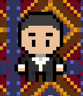
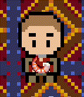
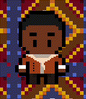
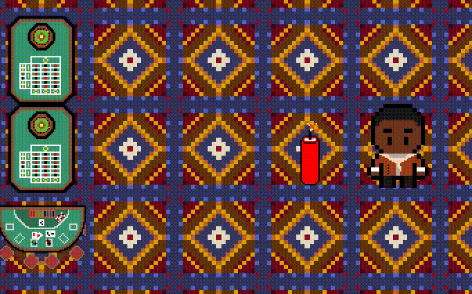

# 🐬 so_long

## 📝 About

**so_long** is the first graphic project from **École 42** introducing students to **basic computer graphics** and **game dev**.

The objective is to create a 2D *(top view)* game with `MiniLibX`. The rules are simple : The player is in a closed map with one or more collectible, and he must collecte them all to open the exit to go inside. 

---

## MiniLibX Usage

Here's a man I create to explain the simple usage of the mlx lib : [So_Long_Man](https://arthuroberon.notion.site/So_Long_Man-19d70fea9d6548e9aa952cf3a955a9ce).

## ⚙️ Usage

### 🏗️ Compilation

```sh
make				# make the game
make bonus			# make the game
make clean			# remove object files
make fclean			# remove object files + so_long
make re				# rebuild everything
```

###  Play

#### Create a Map


First, you have to create a map file respecting the following rules :
- Having a `.ber` extension on the file.
- constructed with 3 components: walls, collectibles, and free space.
- composed of only these 5 characters:
	- `0` for an empty space.
	- `1` for a wall.
	- `C` for a collectible.
	- `E` for a map exit.
	- `P` for the player’s starting position.
- must contain
	- 1 exit.
	- 1 starting position.
	- at least 1 collectible.
- must be rectangular.
- must be enclosed/surrounded by walls.

Here a example of a minimalist `.ber` map :
```
1111111111111
10010000000C1
1000011111001
1P0011E000001
1111111111111
```

If you don't want to create your own map, there plenty of valid map in the following folder : `maps/valid/`.

### Launch the Game

Then, to launch the game, simply execute this command :

```sh
./so_long <path_to_your_map>
```


But before to play, think to read the cover :

---

## 💵 Ocean's Eleven

			A smash and grab job?
			-
			Slightly more complicated than that.

Tonight, proceed to the biggest heist that Las Vegas has never see. Steal 160 000 000 $ in the safe of 3 casinos : The Bellagio, Mirage, and the M.G.M. Grand.

Play as Danny, Rusty, Linus and Basher to go through the casino maze, security guards and codes to get access to the vault.   
And do not underestimate your team, each has there very own talent !

			There's a 95-pound Chinese man with 160 million dollars behind this door.
			-
			Let's get him out.

In this game, there is plenty of new features enemies, QTE, dialogue, and much more.
To play, execute the following command :
```sh
bash game.sh
```


			You're either in or you out

---


### Game Cover

The basic move set :
```
W : move up
S : move down
A : move left
D : move right
```

Here's Danny :



His talent for always being one step ahead gives him 2 hearts, allowing him to be caught once before being arrested.


Here's Rusty :



Always eating, he passes more discreetly by the guards, they detecte less around them when he is played.


Here's Linus :


Thanks to his pickpocketing skills, he can retrieve a code from the guards' pockets.
To do this, the guard must be within his pickpocketing range *(represented by the hands around Linus)*. Pickpocketing a guard will trigger a QTE, where you must stop the bar in the green zone *(middle one)*.

```
Space : Action button for the QTE
```


Here's Basher :



An explosives expert, he always has what it takes to bring down walls *(and more)*.
Basher can stack up to 5 sticks of dynamite in a charge, and he can also remove them. The heavier the charge, the bigger the explosion. 

```
Space : Plant a bomb
Delete : Retrieve a bomb
```




This is a security guard :


But do not cross his eyesight, or be ready to run away.


---

#### Settings Man

You can change several setting in the `so_long.h` file.
Here is the main settings available :

```h
# define SPEED 700

# define FPS_CAP 125

// |---- GUARD ----|

# define SPEED_GUARD 450
# define DELAY_TURN_GUARD 2.5
# define DELAY_GUARD_CHASE_PLAYER 6

// |---- INVINCIBILITY FRAME ----|

# define DELAY_IFRAMES 1.5

// |---- QTE ----|

# define QTE_EASY	0			// Can retry a QTE and not being chased on the 1st failed (0 -> false, 1 -> true)

// |---- DYNAMITE ----|

# define BOMB_TIMING 1.3
# define BOMB_NUMBER 5
# define DELAY_BOMB_EXPLOSION 0.7
```

---

			and for God's sakes whatever you do, don't under any circumstances --

